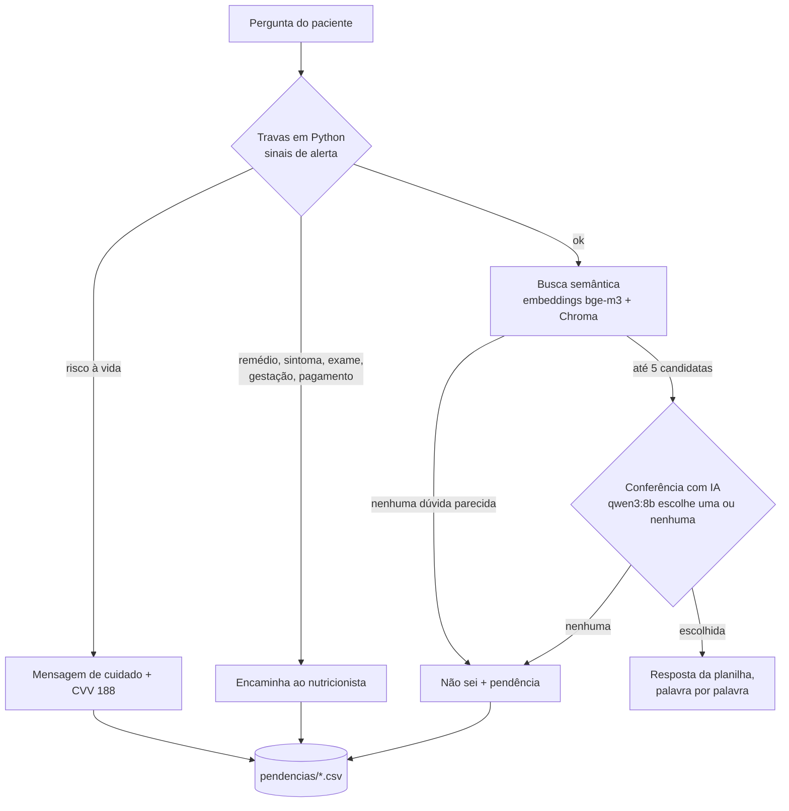

# NutriAssist

Assistente de dúvidas para pacientes em acompanhamento nutricional, feito em Python e rodando 100% local, sem custo de API.

O paciente pergunta no chat ("vou num japonês, o que eu peço?") e o assistente devolve a resposta escrita e revisada pelo nutricionista, palavra por palavra. A IA não escreve a resposta: ela só ajuda a encontrar qual dúvida da base combina com a pergunta. Perguntas sobre remédio, sintomas, exames ou mudança de plano nunca são respondidas automaticamente e vão para o profissional.

> Esta é uma versão de demonstração: traz cerca de metade da base de dúvidas (450 de 903) e nenhum dado pessoal, de pacientes ou de marca. A arquitetura é a mesma da versão completa.

## Arquitetura



| Peça | Arquivo | O que faz |
| --- | --- | --- |
| Base de dúvidas | `dados/duvidas_exemplo.csv` | Cada dúvida tem 1 pergunta + 4 variações, objetivo, cuidado, resposta e fonte |
| Fontes | `dados/fontes.csv` | Significado dos códigos da coluna `fonte` |
| Embeddings | `embeddings.py` | Um único lugar define o modelo, para indexação e busca nunca divergirem |
| Indexação | `indexar_duvidas.py` | Guarda cada jeito de perguntar no banco vetorial (Chroma), todos apontando para o mesmo ID |
| Cérebro | `nutriassist.py` | Travas, busca, conferência com IA e registro de pendências |
| Interface | `app.py` | Chat em Streamlit, navegação por tema e página "Sobre" |
| Avaliação | `calibrar.py` | 28 perguntas de dieta escritas de um jeito novo + 15 fora do assunto |

## Decisões de projeto

- **A IA não gera texto para o paciente.** Respostas vêm de uma base revisada por um profissional. Isso elimina respostas inventadas e mantém a responsabilidade clínica com quem assina.
- **Travas determinísticas antes da IA.** Sinais de alerta são checados em Python puro, com lista de palavras testada contra a base inteira para evitar falsos positivos ("tipo sanguíneo" não é sangramento).
- **Recusar é melhor que errar.** Quando não há dúvida parecida o bastante, o assistente diz que não sabe e registra a pergunta para o profissional responder.
- **Medir antes de mudar.** Toda troca de modelo ou de regra passa pelo `calibrar.py`.

## Resultados da avaliação

| Versão | Dieta: certas | Dieta: erradas | Fora do assunto recusadas |
| --- | --- | --- | --- |
| nomic-embed-text, limite de distância | 20 de 28 | 8 | 0 de 15 |
| bge-m3 | 24 de 28 | 4 | 14 de 15 |
| bge-m3 + conferência com qwen3 (atual) | 25 de 28 | 3 | 15 de 15 |

O modelo de embeddings inicial, treinado majoritariamente em inglês, confundia detalhes do português como "café da manhã" e "café" (bebida), ou "antes" e "depois" do treino. Os 3 erros restantes são dúvidas muito parecidas dentro da própria base. Resultados medidos com a base completa.

## Como rodar (Windows)

Pré-requisitos: Python 3.11+ e [Ollama](https://ollama.com) instalados.

```powershell
ollama pull bge-m3
ollama pull qwen3:8b

python -m venv .venv
.venv\Scripts\activate
pip install -r requirements.txt

python indexar_duvidas.py      # monta o banco de busca
python nutriassist.py          # testa no terminal (digite "sair" para encerrar)
streamlit run app.py           # abre a interface no navegador
python calibrar.py             # roda a avaliação
```

Imagens de marca são opcionais: coloque `assets/personagem.png`, `assets/personagem_corpo.png` e `assets/logo.png` para personalizar. Sem elas, o app usa um emoji como avatar.

## Aviso

Projeto de estudo e demonstração. As respostas da base são rascunhos em revisão e não substituem consulta com nutricionista. Todos os direitos reservados: o código pode ser lido e estudado, mas não foi liberado para reutilização.
